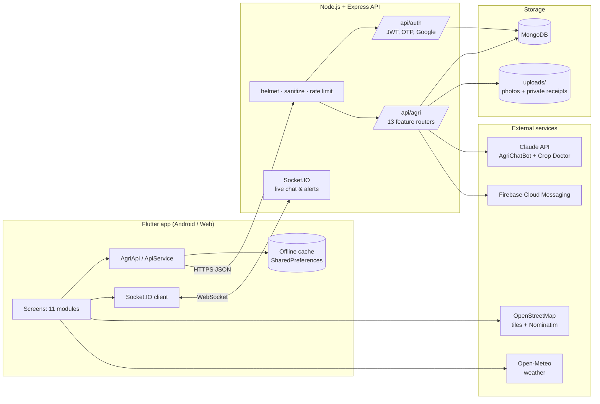
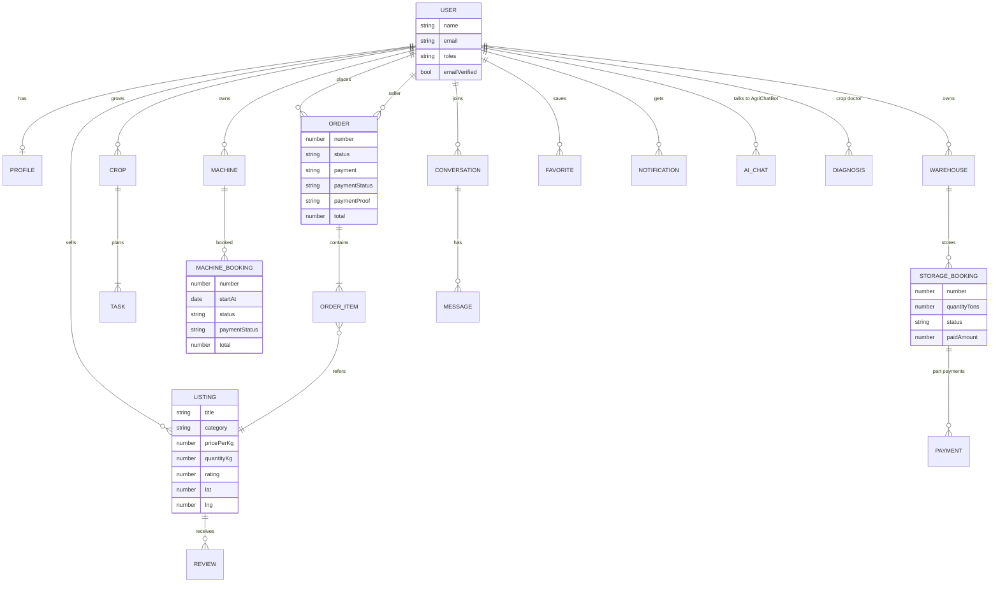
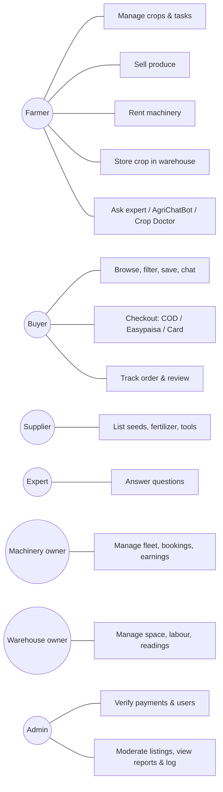
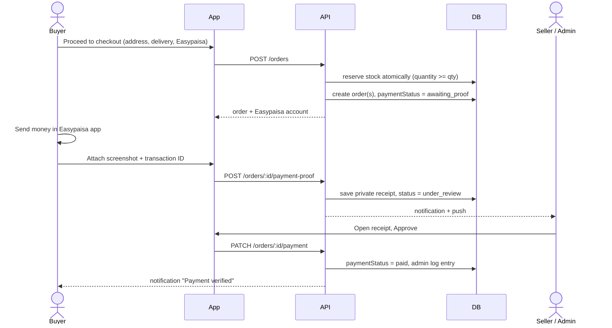
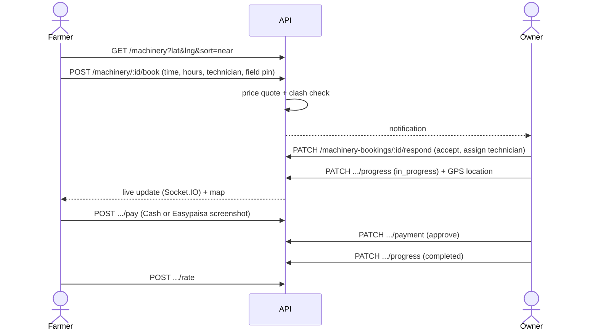
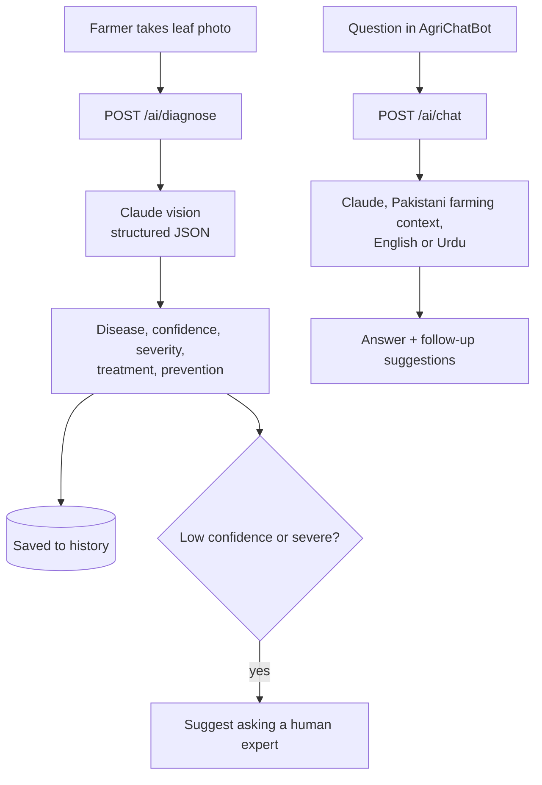

# AgriSphere — Architecture & Design Diagrams

Diagrams are written in [Mermaid](https://mermaid.js.org/); GitHub renders them automatically.
To export images for the report, paste a block into <https://mermaid.live> and download PNG/SVG.

---

## 1. System architecture

## 2. Database (ER diagram, main collections)

## 3. Use cases

## 4. Sequence — checkout with Easypaisa

## 5. Sequence — machinery booking

## 6. AI features

